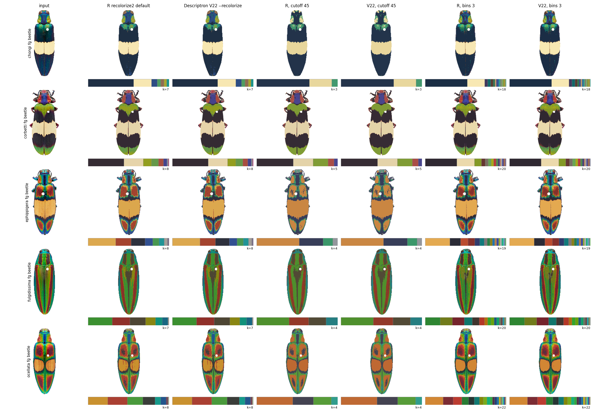
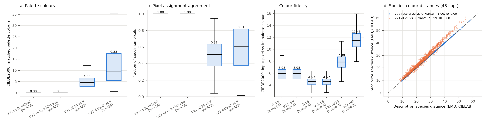

# Descriptron `--recolorize` against R recolorize

`FHS_and_CLAHE_V22.py --recolorize` is an original Python implementation of the colour segmentation in
`recolorize2()`, from the R package recolorize 0.2.0 (Weller, Hiller, Lord & Van Belleghem 2024,
*Methods in Ecology and Evolution*; CC BY 4.0). It runs in three steps:

1. The foreground pixels go into a histogram of bins³ boxes in sRGB, and each occupied box is coloured by the mean of its pixels.
2. The box colours are merged by hierarchical clustering on Euclidean CIELAB distance, cut at the cutoff, with pixel-weighted means.
3. Every pixel is reassigned to the nearest merged colour in CIELAB, and each colour is reset to the mean of its pixels (`imposeColors`).

R's colour conversion is reproduced exactly: grDevices' D65 white (x 0.3137, y 0.3291) and its rounding to 5
decimals. `--recolorize_white CIE` gives the standard white point instead.

With the flags alone, `--recolorize` equals `recolorize2()` at its defaults (2 bins, complete linkage, cutoff 20).
The Descriptron pipeline (`run_full_pipeline_v2.py --colour_method recolorize`, the default) and GUI v99 use
8 bins, average linkage and cutoff 20 instead. The cutoff can also be `median` or `mean` of the per-image
silhouette-best ΔE, which is Descriptron's own rule. `--colour_method descriptron` (GUI: untick *recolorize*)
keeps the Descriptron method: Felzenszwalb superpixels, CLAHE, background chromaticity correction and LAB
averaging. Use it when photographs come from different imaging rigs and hue differences between rigs must be
removed.

## Results

### recolorize's own example beetles

These are the five *Chrysochroa* images shipped in recolorize's `extdata` (CC BY 4.0). V22 and R were run on the same
pixels; the colours of matched pairs are compared in CIEDE2000.

| setting | same number of colours | largest colour difference (ΔE00) | pixels on the same colour (worst image) |
|---|---|---|---|
| `recolorize2()` defaults | 5 / 5 | 0.046 | 99.990 % |
| cutoff 45 | 5 / 5 | 0.025 | 99.982 % |
| bins 3 | 5 / 5 | 0.006 | 99.993 % |

The largest differences are in colours that gained or lost a few of R's tie pixels (see below), which moves that
colour's mean slightly; 11 of the 15 image-setting pairs are identical (0.000).

`measure/tests/test_recolorize_v22.py` repeats this check on every install, using R's palettes in
`tests/data/recolorize_beetles/`.

### 423 moth photographs, 43 species

These are GBIF photographs of the species of Nokelainen et al. 2024, from the moth validation in
`validation/moths_nokelainen2024/`. The masks are the Descriptron segmentations of that run.

| setting | same number of colours | largest colour difference (ΔE00) | pixels on the same colour (worst image / median) | species colour tree vs R | run time V22 / R |
|---|---|---|---|---|---|
| recolorize2 defaults | 423 / 423 | 0.020 | 99.979 % / 100 % | Mantel r 1.0000, Robinson–Foulds 0 | 2.6 / 43 min |
| 8 bins, average linkage, cutoff 20 | 423 / 423 | 0.019 | 99.965 % / 99.998 % | Mantel r 1.0000, Robinson–Foulds 0 | 3.4 / 62 min |

The pixels that differ are pixels whose two nearest colours lie within R's tie tolerance. R's `max.col` assigns
those at random (`ties.method = "random"`), so two R runs differ by as much.

The species trees are UPGMA trees on the mean earth mover's distance between specimen palettes in CIELAB
(`scripts/trees.R`). These trees are not stable within any method: trees built from the two halves of each
species' specimens differ in 83–93 % of their splits (Robinson–Foulds). Compare methods by the Mantel
correlation of their distances (0.93 between halves) rather than by tree shape.

For comparison, V21 (before the 4 Nov 2026 colour fixes) differs from recolorize. Medians per image:

| comparison | colours (V21 / R) | matched colours ΔE00 | pixels on the same colour |
|---|---|---|---|
| V21 ΔE 20 vs R, 8 bins, average linkage | 4 / 6 | 4.6 | 51 % |
| V21 default (median ΔE) vs R default | 3 / 3 | 9.3 | 61 % |

Colour fidelity is the ΔE00 between each pixel and its assigned colour, median per image. It is 4.6 for 8 bins
with average linkage, 6.0 for recolorize2's defaults, 7.9 for V21 at ΔE 20 and 11.5 for V21's default. Part of
the gain for 8 bins comes from keeping more colours (median 6 vs 3).

## Reproducing

R 4.3 with recolorize 0.2.0, emdist, ape, phangorn and vegan (`scripts/install_recolorize.R <lib>`). Every script
takes its folders as arguments or environment variables; none has paths written in. Run them one after another:

1. `scripts/prep_rgba_inputs.py` writes RGBA PNGs (alpha = the Descriptron mask) for R.
2. `scripts/run_recolorize.R` runs R recolorize (configurations `default`, `b8_avg_T20`, ...).
3. `scripts/run_v22_full.sh` runs V22 `--recolorize` with the same two settings, then `scripts/compare_v22_vs_R.py`.
4. `scripts/run_R_beetles.R` runs the beetle reference.
5. `scripts/compare_palettes.py`, `scripts/matched_full_precision.py`, `scripts/trees.R`, `scripts/compare_species.py`,
   `scripts/make_summary_figure.py` and `scripts/make_side_by_side.py` make the tables in `results/` and the figures.

## Homology grid warped by landmarks + sliding semilandmarks, and the patternize / Colormesh benchmark (5 Nov 2026)

These runs use:
- **The semilandmarks.** V42 GPA with `--alignment_method reflect_mirrored --slide_method bending`. The slid
  semilandmarks are put back onto each specimen's outline (`--slid_on_outline project`, the default since 2.8.7;
  shape statistics are unchanged).
- **The grid.** The colour and texture homology grids are warped by the fixed landmarks plus the semilandmarks
  (`homology_landmarks_v1.py`; `--landmarks auto` is the default).
- **The statistics.** `descriptron_trait_stats` scores leave-one-out nearest-neighbour species identification on
  all PCs, with Wilson 95% intervals. The exact McNemar test it reports is on PC1-5.

**Diaphorina forewings** (48 wings, 9 species; only numbers are published for these specimens). Tables are in
`results/homology_20261105/` and `results/colour_benchmark_recolorize_20261105/`:

| method | input images | species identified | 95% interval | PERMANOVA R² |
|---|---|---|---|---|
| Descriptron colour grid | normalise + recolorize | 94% | 83-98 | 0.75 |
| Descriptron texture grid | photos | 94% | 83-98 | 0.83 |
| Descriptron colour grid | photos | 92% | 80-97 | 0.73 |
| Descriptron colour grid | recolorize | 88% | 75-94 | 0.71 |
| Colormesh 2.1 | normalise + recolorize | 81% | 68-90 | 0.67 |
| patternize 0.0.5 | normalise + recolorize | 77% | 63-87 | 0.67 |
| patternize 0.0.5 | photos | 71% | 57-82 | 0.66 |
| Colormesh 2.1 | photos | 65% | 50-77 | 0.56 |

- **How patternize and Colormesh were run.** Both used the settings of the 28 Sep 2026 benchmark
  (`validation/colour_benchmark_*.R`). For the recolorized rows, each wing's pixels were swapped for the
  recolorized wing on the same canvas with the same landmarks (`scripts/prepare_recolorized_benchmark_inputs.py`).
- **Paired test (exact McNemar, PC1-5).** Descriptron differs significantly from Colormesh on photos
  (P = 0.004). It does not differ significantly from patternize on photos (P = 0.25), Colormesh on recolorized
  wings (P = 0.06) or patternize on recolorized wings (P = 0.38).
- **Grid slippage.** Share of the warped grid outside the wing, and interior error with one landmark left out:
  - 17 landmarks only (the patternize route): 3.3% outside, 1.75% interior error;
  - 100 semilandmarks only: 0.3% outside, 2.45%;
  - both together: 0.7% outside, 1.94%.

**Moths** (423 specimens, 43 species):
- The grid fits the AI mask with a median IoU of 0.82 at 4 control points and 0.976 at 100 (0.933 before the
  slid points were projected).
- Kmult of the colour-pattern grid, all P ≤ 0.002:
  - Descriptron method: 0.72
  - recolorize: 0.67
  - photos: 0.66
  - normalise + recolorize: 0.65
- Normalisation did not reduce the difference between the two museums: the Mantel r between ETHZ and TAM
  species means was 0.95 without it and 0.92 with it. Recolorize without normalisation therefore stays the
  default.

Figures:
- `figures/descriptron_vs_tools_20261105.png`, made by `scripts/make_descriptron_vs_tools_figure.py`;
- `figures/colour_benchmark_pca_recolorize.png`, made by `scripts/make_recolorize_benchmark_pca_figure.py`.

## Licences of the images

- The beetle images are from recolorize's `extdata` (CC BY 4.0, Weller et al. 2024).
- No moth or Diaphorina photographs are included. The figures show only numbers and plots.
